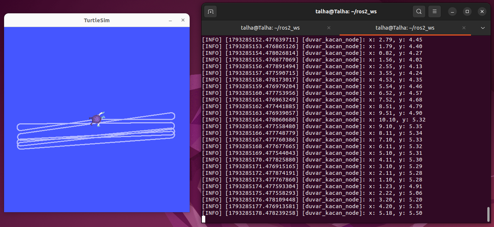

# Duvardan Kaçan Kaplumbağa (ROS 2)

Bu paket, ROS 2 turtlesim simülasyonundaki kaplumbağanın konumunu dinleyerek duvar sınırlarına yaklaştığında otomatik olarak yön değiştirmesini sağlar.

* **Subscriber:** `/turtle1/pose` konusundan anlık `x` ve `y` koordinatlarını alır.
* **Publisher:** `/turtle1/cmd_vel` konusuna hız komutları gönderir; sınır dışına çıkıldığında açısal hız vererek kaplumbağayı döndürür.
* **Loglama:** Saniyede bir kez güncel konumu terminale yazdırır.
* **Parametreler:** Hız ve sınır değerleri ROS 2 parametresi olarak dışarıdan değiştirilebilir.

## Ekran Görüntüsü

